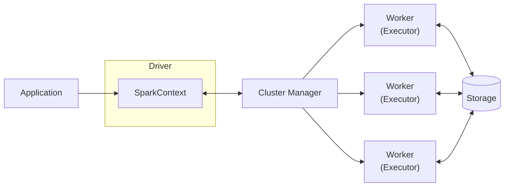

# Dataset
https://www.kaggle.com/datasets/new-york-city/ny-311-service-requests?resource=download

# Apache Spark Architecture

- **Driver**: plans the job and schedules tasks.
- **SparkContext**: the Driver's connection to the cluster; creates jobs and talks to the Cluster Manager.
- **Cluster Manager**: allocates resources (Standalone, YARN, Kubernetes).
- **Workers / Executors**: run tasks in parallel and cache data.
- **Storage**: HDFS, S3, Parquet, databases, etc.
