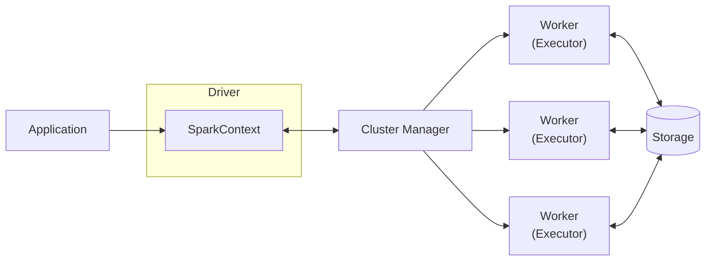
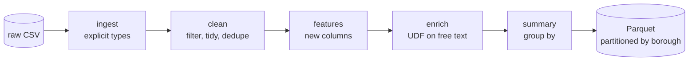

# NYC 311 service requests: Spark ETL

Dataset: https://www.kaggle.com/datasets/new-york-city/ny-311-service-requests?resource=download
Reads the raw 311 CSV (14.7 GB, about 22M rows)

# Apache Spark Architecture



- **Driver**: plans the job and schedules tasks.
- **SparkContext**: the Driver's connection to the cluster; creates jobs and talks to the Cluster Manager.
- **Cluster Manager**: allocates resources (Standalone, YARN, Kubernetes).
- **Workers / Executors**: run tasks in parallel and cache data.
- **Storage**: HDFS, S3, Parquet, databases, etc.

## Pipeline



## Running

```bash
cd se-spark
source .spark-env/bin/activate
python src/run_etl_pipeline.py
python src/run_summary.py
```
**borough and complaint type**, saved as Parquet with one folder per borough.

Output goes to `data/etl_output/`: `summary/` (the final table) and `requests/` (one row per request),
both partitioned by `borough` & `complaint_type`.
